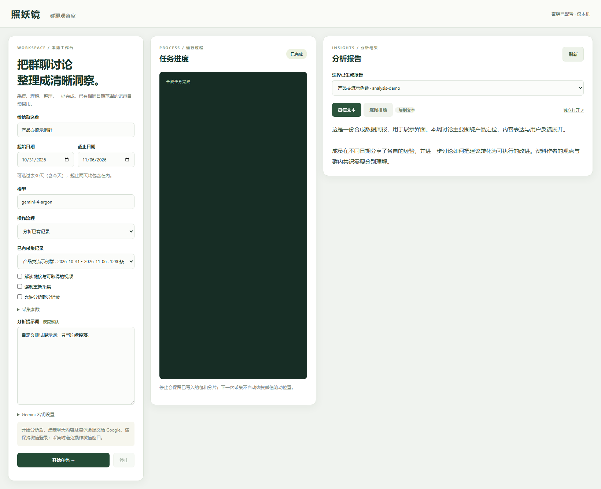

# 照妖镜 · ZhaoYaoJing

本地部署的微信群聊周报工具。回溯指定群的一周消息，使用 Gemini Argon 整理最多十个热门议题、成员贡献、共识与分歧，输出适合微信发送的精简短句、列表和截图排版。

浏览器控制台采用 Python 标准库服务和原生 HTML/CSS/JavaScript，无前端构建步骤。微信采集需要 Windows、已登录的微信和兼容且已激活的 wxautox4；分析已有数据不需要微信。



## 快速开始（Windows）

安装 **Python 3.11 64 位**，克隆仓库，然后双击 `setup_windows.bat`。安装成功后双击 `start_browser.bat`，浏览器打开 `http://127.0.0.1:8765`。

```bat
py -3.11 -m venv .venv
.venv\Scripts\activate.bat
python -m pip install -r requirements-wechat.txt
python local_app.py
```

wxautox4 授权请按供应商流程在本机配置；本仓库不分发激活工具或第三方库源码。系统 Python 3.14 不适合该链接库。只分析已有数据或运行测试时，可以只安装 `requirements.txt`。

## 浏览器操作

左侧输入完整群名、起始周六、模型与提示词，并选择“采集并分析”“仅采集”“分析已有记录”或“复用分析分片，只重新汇总”。中间显示日志，右侧分屏查看精简微信文本和 HTML 排版，可复制全文、独立打开后截图或打印 PDF。

统计周期为悉尼时间周六00:00至下周六00:00，不含结束时刻；默认选最近结束的一周。例如2026-11-08默认统计2026-10-31至2026-11-06。采用自然日，跨夏令时周不一定是168小时。

已有同群同周期的有效记录自动复用，不重新连接微信；未完成或损坏记录不当作完整周记录。强制重新采集会新建目录，原记录保留。

密钥可在页面密码框临时设置，仅本地服务本次进程有效，不保存到文件、不回显。也支持 `GEMINI_API_KEY` 环境变量及Windows用户变量；无需反复重开终端。配置存在不代表拥有模型访问权限。

提示词保存于每次报告的 `prompt.txt`，用于分片和最终汇总。重新汇总旧分片时，新提示词不会重做旧分片的分析。

## 既有数据与命令行

数据默认在不提交Git的 `outputs/`。可指定已有数据目录：

```bat
python local_app.py --data-dir "E:\Projects\WeChat-AI\outputs"
```

命令行仍可用：

```bat
python weekly_chat.py --start 2026-10-31 --batch 100 --max-pages 1000 --page-timeout 120 --analyze --media
python gemini_analysis.py "outputs\采集目录" --media
python gemini_analysis.py "outputs\采集目录" --resume-analysis "outputs\采集目录\analysis-原目录"
```

可用 `--prompt-file 自定义提示词.txt`、`--model 模型ID` 覆盖分析配置。独立分析部分记录加 `--allow-partial`；强制采集用 `--force-collect`。分片全部完成但汇总失败时可在页面选原分片目录，只重新汇总。

## 输出文件

| 文件 | 用途 |
| --- | --- |
| `*-pages/page-NNNN.json`、`history.sqlite3` | 原始历史包及磁盘索引 |
| `raw.json`、`messages.json`、`transcript.jsonl` | 原始、周期筛选后及逐行消息 |
| `coverage.json`、`uncertain.json`、`excluded.json` | 覆盖情况、时间不明及排除记录 |
| `activity.csv` | 发言量、字数与活跃天数 |
| `transcript-media.jsonl`、`media-coverage.json` | 媒体解读及未读情况 |
| `analysis-*/wechat.txt`、`wechat-01.txt`等 | 微信全文及分条文本 |
| `analysis-*/wechat.html` | 可截图排版，不是自动生成PNG |
| `analysis-*/chunk-NNNN.json`、`evidence.sqlite3` | 分片及恢复核对材料 |
| `analysis-*/citation_warnings.json` | 引用警告，不阻断报告 |

## 能力与限制

固定分包历史采集即时落盘，导出用磁盘游标，不累计整周消息。日期跨日或时间回退不会提前停止。停止会终止子进程，已完成包保留，但不自动恢复微信滚动位置。

UI可见历史不等于绝对完整历史，未同步及删除内容无法恢复。跨包部分重叠尚未全面消除，统计是初步结果；昵称不是唯一账号ID，时间分隔符提供近似时间。贡献分析不是事实认证或个人评价。

媒体支持公开网页可见文字、直接视频及HTML中可取得的直接视频地址，首版单视频上限12MiB。需要登录、动态播放器、HLS/DRM等不保证取得。旧记录只有“[视频]”或卡片不暴露URL时无法凭空恢复。媒体作者观点不归属分享者，字幕和网页段落不增加群消息数。解读按内容、模型和提示词版本缓存。

引用缺失或核验失败时跳过该引用，保留概括分析，不把它称为已核验。网络/API、权限、格式错误或截断仍可能失败，原数据保留。模型结论及视频时间戳需人工抽查。

## 隐私与开发

服务仅监听127.0.0.1，有Host校验、写请求令牌和结果路径限制，不应代理到公网。启动分析会向Google提交选定聊天及媒体。本工具不自动向群发消息。真实数据、密钥、日志、虚拟环境、第三方二进制均不上传GitHub。

更多说明：[用户手册](docs/USER_GUIDE.md)、[架构与数据流](docs/ARCHITECTURE.md)、[开发与验证](docs/DEVELOPMENT.md)、[隐私与发布](docs/PRIVACY.md)、[变更记录](CHANGELOG.md)。

```bat
python -m unittest discover -v
```

测试使用合成数据与模拟模型，不调用付费API。真实历史读取和一次27分片汇总曾在本机完成；新界面流程和媒体下载与翻页组合仍需按实际客户端验证。


### 报告阅读格式

默认报告目标600至900字，尽量不超过1200字。优先保留3至5个重要议题，不凑数；问题和待办用短列表，每项最多两句。贡献最多概述3人，避免人名和原文堆砌。技术覆盖字段、逐条消息ID和引用括号不出现在正文，内部证据仍保留在分片文件。

新格式只作用于新生成的报告。已有长报告可在界面选择“复用分析分片，只重新汇总”生成精简版本，无需重新采集或分析全部分片。
