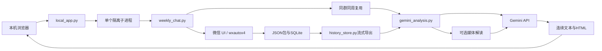

# 架构与数据流

本地服务用无shell参数数组调用原有命令，不维护第二套采集逻辑。提示词写入忽略提交的.local目录；密钥不进入命令参数。锁保证单任务，日志缓冲限制1500行，浏览器定时轮询。

采集固定请求数量，goback=False保持历史位置。时间分隔符按块整理，允许UI加载造成的回退。SQLite按包逆序导出；部分重叠仍需审查，不依赖会变化的UI ID删除内容相同的真实发言。

分析采用分片候选发现与最终汇总，引用尽力校验而不阻断正文。恢复分片先比对消息范围。视频或网页作者观点不等于分享者观点，更不代表群共识。
